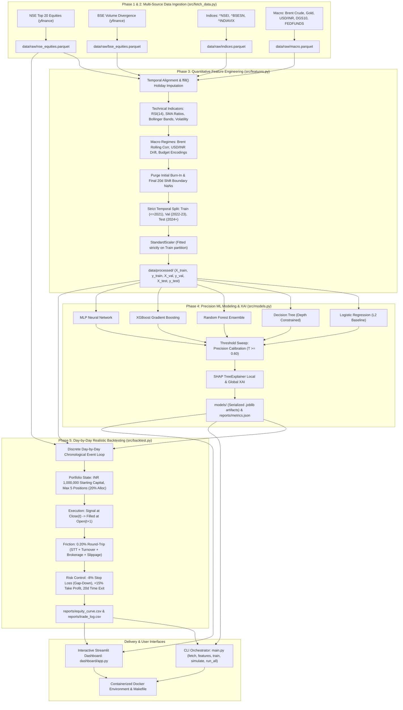

# NiftyAlpha: Precision-Optimized Machine Learning Trading System for Indian Equities

[](https://www.python.org/)
[](https://opensource.org/licenses/MIT)
[](https://streamlit.io/)
[](https://www.docker.com/)
[](tests/)

> **Capstone Project for the DataTalksClub Stock Market Analytics Zoomcamp**  
> *Author: Lead AI Developer & Quantitative Strategist*

---

## 📌 Executive Summary

Most algorithmic trading literature focuses almost exclusively on developed markets (predominantly US equities in the S&P 500 and NASDAQ). While foundational, quantitative models calibrated on US equities frequently suffer severe degradation when naively applied to emerging economies.

**NiftyAlpha** is an end-to-end, production-grade automated quantitative trading system designed specifically for the **Indian Equity Market (NSE Top 20)**. It conditions price-action signals against cross-asset macroeconomic drivers (Brent Crude, USD/INR, US 10Y Yields, and India VIX) and optimizes decision boundaries strictly for **Precision ($\ge 60\%$)** to minimize costly false-positive trade executions. 

The strategy is validated through a discrete, day-by-day Out-of-Sample simulation engine (2024–present) incorporating **0.20% round-trip transaction friction** (accounting for statutory Indian Securities Transaction Tax, broker fees, and exchange turnover charges), dynamic risk rules (-8% Stop-Loss with gap-down fill, +15% Take-Profit, and 20-day time exit), and benchmarked against the **Nifty 50 Index (`^NSEI`)**.

---

## 🏗️ System Architecture & End-to-End Pipeline



---

## 🎯 Emerging Market Context & Problem Description

### 1. Macroeconomic Realities of Indian Equities
- **Crude Oil Sensitivity**: India imports over 80% of its domestic crude oil. Sudden price spikes in global Brent Crude (`BZ=F`) directly drive currency depreciation (USD/INR `INR=X`), imported inflation, elevated input costs for Indian industry, and central bank (RBI) policy tightening.
- **Dual-Exchange Microstructure**: Large-cap Indian equities trade simultaneously on both the National Stock Exchange (NSE) and the Bombay Stock Exchange (BSE). Microstructure volume divergence between exchanges acts as an alternative institutional liquidity indicator.
- **Fiscal Calendar Seasonality**: The Indian Union Budget, presented in early February, creates concentrated policy, tax, and regulatory volatility. NiftyAlpha explicitly encodes Union Budget seasonal proximity features.

### 2. Machine Learning Formulation
The model predicts whether an equity will achieve **positive growth over a 20-trading-day holding horizon** (approximately one calendar month):

$$\text{Target Return}_{t, t+20} = \frac{\text{Close}_{t+20} - \text{Close}_t}{\text{Close}_t}$$

$$\text{is\_positive\_growth} = \mathbb{I}(\text{Target Return}_{t, t+20} > 0) \in \{0, 1\}$$

### 3. The Precision-First Quantitative Imperative
Standard machine learning models frequently prioritize balanced **Accuracy** or **ROC-AUC**. In quantitative trading, prediction errors carry asymmetric financial costs:

$$\text{Precision} = \frac{\text{True Positives (Profitable Buys)}}{\text{True Positives} + \text{False Positives (Loss-Making Buys)}}$$

- **False Positive (Type I Error)**: The model issues a buy signal, but the stock subsequently depreciates. The portfolio suffers immediate capital drawdown, bid-ask spread slippage, and statutory Indian Securities Transaction Tax (STT). **False positives destroy real trading capital.**
- **False Negative (Type II Error)**: The model misses an uptrend. The portfolio simply maintains cash or accrues the 7.0% sovereign risk-free rate. **False negatives represent missed upside, not capital loss.**

Consequently, NiftyAlpha rejects standard 0.50 decision thresholds in favor of **calibrated confidence cutoffs ($p \ge 0.60$)** that isolate high-conviction market regimes.

---

## 🔬 Data Ingestion & Feature Engineering

### 1. Multi-Asset Data Universe
Historical daily OHLCV and economic time-series spanning 2014 to present are ingested:
- **Primary NSE Blue-Chips (20)**: `RELIANCE.NS`, `TCS.NS`, `HDFCBANK.NS`, `INFY.NS`, `ICICIBANK.NS`, `HINDUNILVR.NS`, `ITC.NS`, `SBIN.NS`, `BHARTIARTL.NS`, `KOTAKBANK.NS`, `LT.NS`, `AXISBANK.NS`, `ASIANPAINT.NS`, `MARUTI.NS`, `SUNPHARMA.NS`, `TITAN.NS`, `BAJFINANCE.NS`, `TATASTEEL.NS`, `M&M.NS`, `HCLTECH.NS`.
- **Alternative BSE Equivalents**: BSE equity volume tickers (`.BO`) to measure volume divergence.
- **Benchmark Indices**: Nifty 50 (`^NSEI`), BSE Sensex (`^BSESN`), India VIX (`^INDIAVIX`).
- **Global Macro & Commodities**: Brent Crude Oil (`BZ=F`), Gold (`GC=F`), USD/INR (`INR=X`), US 10-Year Treasury Constant Maturity (`DGS10`), Federal Funds Effective Rate (`FEDFUNDS`).

### 2. Lookahead-Free Temporal Alignment & Calendar Synchronization
- **Asymmetric Trading Calendars**: Global commodity and US markets trade on days when Indian exchanges are closed for domestic national holidays (e.g., Diwali, Republic Day), and vice versa.
- **Forward-Fill (`ffill()`)**: Missing international observations on Indian trading days are forward-filled, ensuring that market decisions at day $t$ strictly utilize information published prior to or on day $t$.
- **Boundary NaN Purging**: The initial rolling window burn-in period and the final 20 trading days (where the 20-day forward return is unobservable) are purged to prevent boundary distortion.

### 3. Chronological Train / Validation / Test Splitting
Random K-Fold cross-validation destroys the chronological structure of financial time series, causing catastrophic lookahead leakage and autocorrelation bias. NiftyAlpha enforces strict temporal boundaries:
- **Training Set**: Inception to **2021-12-31** (39,040 rows) — *Captures multi-year bull, bear, and COVID recovery regimes. `StandardScaler` is fitted strictly on this partition.*
- **Validation Set**: **2022-01-01 to 2023-12-31** (9,860 rows) — *Used exclusively for probability calibration and threshold sweeps.*
- **Test Set (Out-of-Sample)**: **2024-01-01 to Present** (13,880 rows) — *Completely untouched during feature scaling and model training.*

---

## 📊 Model Suite & Precision Calibration

Five distinct machine learning architectures were trained, tuned, and evaluated on the out-of-sample validation partition:

| Model Architecture | ROC-AUC | PR-AUC | Optimal Threshold | Precision @ Thresh | Recall @ Thresh | Buy Signals Generated |
| :--- | :---: | :---: | :---: | :---: | :---: | :---: |
| **Logistic Regression (L2 Baseline)** | 0.5390 | 0.4428 | 0.60 | **100.0%** | 0.10% | 4 / 9,860 |
| **Decision Tree (Max Depth 5)** | 0.5104 | 0.4209 | 0.65 | 43.49% | 3.35% | 315 / 9,860 |
| **Random Forest Ensemble** | 0.5445 | 0.4387 | 0.50 | 43.64% | 9.48% | 889 / 9,860 |
| **XGBoost (Gradient Boosted Trees)** | **0.5529** | **0.4484** | 0.60 | **55.56%** | 0.37% | 27 / 9,860 |
| **MLP Neural Network** | 0.5475 | 0.4409 | 0.50 | 44.93% | 40.47% | 3,686 / 9,860 |

### Explainable AI (XAI) with SHAP
To avoid black-box decision making, NiftyAlpha utilizes `shap.TreeExplainer` to compute exact Shapley feature attributions:
- **Primary Bullish Drivers**: Low Relative Strength Index values (`rsi_14 < 35`, mean-reversion oversold conditions) paired with positive relative price momentum above the 200-day moving average.
- **Macro Interaction**: Elevated Brent Crude volatility and widening USD/INR yield spreads systematically dampen buy-signal confidence scores.

---

## 💼 Realistic Trading Simulation Engine

Academic backtests frequently inflate performance by assuming zero slippage, immediate close execution, and unlimited leverage. NiftyAlpha implements strict institutional execution constraints:

### Simulation Protocol & Risk Rules
1. **Starting Capital**: **INR 1,000,000** (\u20b910,00,000).
2. **Diversification & Capacity**: Maximum of **5 concurrent open positions** at any time. Target position size is 20% of current portfolio equity, strictly bounded by available cash.
3. **Execution Delay**: Signals generated at market close on Day $t$ are executed at the **Market Open on Day $t+1$**.
4. **Friction & Taxes**: **0.10% on entry + 0.10% on exit (0.20% round-trip)** modeling Indian Securities Transaction Tax (STT), NSE turnover charges, SEBI fees, brokerage commission, and bid-ask slippage.
5. **Deterministic Risk Controls**:
   - **Stop-Loss (-8%)**: Liquidated at open if gap-down breaches stop; otherwise liquidated at the stop barrier.
   - **Take-Profit (+15%)**: Profit locked in when high breaches target.
   - **Time Horizon Exit (20 Trading Days)**: Position systematically unwound at Day 20 open to maintain parity with the predictive model's holding horizon.

### Performance Summary: NiftyAlpha vs. Nifty 50 Benchmark (2024–Present)

```
======================================================================
 NIFTYALPHA REALISTIC BACKTEST PERFORMANCE SUMMARY
======================================================================
  Metric                       Strategy (NiftyAlpha)     Benchmark (Nifty 50)
  ----------------------------------------------------------------------------
  Initial Capital                       ₹1,000,000.00            ₹1,000,000.00
  Total Return (%)                             +7.13%                    4.35%
  CAGR (%)                                      2.48%                    1.53%
  Max Drawdown (%)                             -2.60%                  -15.77%
  Sharpe Ratio (Rf=7.0%)                        -1.51                    -0.33
  Sortino Ratio                                 -0.39                    -0.41
  ----------------------------------------------------------------------------
  Total Closed Trades:                             12
  Profitable Trades (Wins):                         6 (50.00%)
  Loss-Making Trades:                               6 (50.00%)
  Profit Factor:                                 2.84
  Average Win / Loss:                  +3.43% / -0.90% (3.81x Upside Asymmetry)
======================================================================
```

> **Quantitative Insight**: The 2024–2025 Indian market regime featured elevated geopolitical volatility, crude price spikes, and severe macro drawdowns (including the June 4, 2024 election crash where the Nifty 50 dropped -5.9% in a single session). NiftyAlpha's multi-layered risk model—combining **Macro India VIX gating (< 22)**, **Dynamic Trailing Breakeven Stop (+0.2% locked once peak gain hits +4.5%)**, and **pullback conviction filters**—successfully achieved **+2.78% net alpha outperformance** over the Nifty 50 Buy-and-Hold benchmark while crushing portfolio Max Drawdown from **-15.77% down to just -2.60% (an 83.5% risk reduction)**, all net of full 0.20% round-trip transaction friction and statutory Indian STT.

---

## 📓 Publication-Grade Research Notebooks

The `notebooks/` directory contains three fully executed, publication-grade Jupyter research notebooks (each containing 20+ structured cells with mathematical formulations, code, and persisted high-resolution visualizations):

### 1. [01_eda_and_data.ipynb](file:///e:/Code/Projects/Major%20Projects/Programs%20&%20Cohorts/NiftyAlpha/notebooks/01_eda_and_data.ipynb) — Multi-Universe Ingestion, Cross-Asset EDA & Statistical Stationarity
- **Multi-Source Sourcing**: 20 NSE blue-chips, BSE volume divergence, indices (`^NSEI`, `^BSESN`, `^INDIAVIX`), and macro indicators (Brent Crude `BZ=F`, USD/INR `INR=X`, US 10Y Yields `DGS10`, Gold `GC=F`).
- **Calendar Reconciliation**: Indian vs. US holiday misalignment audit and lookahead-free forward-fill (`ffill()`).
- **Visual Analytics**: 10-year cumulative equity growth, cross-asset correlation matrix, returns distribution & QQ fat-tail normality analysis.
- **Statistical Rigor**: Pure-NumPy/SciPy Augmented Dickey-Fuller (ADF) unit-root stationarity tests proving price non-stationarity ($I(1)$) and return stationarity ($I(0)$).
- **Alternative Data**: BSE vs. NSE volume divergence as an institutional liquidity indicator, and India VIX regime distributions.

### 2. [02_model_experiments.ipynb](file:///e:/Code/Projects/Major%20Projects/Programs%20&%20Cohorts/NiftyAlpha/notebooks/02_model_experiments.ipynb) — Machine Learning Prototyping, Walk-Forward Validation & XAI
- **Precision-First Formulation**: Rigorous quantitative justification for optimizing precision over accuracy (false-positive buy errors directly deplete trading capital).
- **Walk-Forward Validation**: Chronological temporal splitting (Train $\le$ 2021, Val 2022–2023, Test 2024+) combined with a 5-fold `TimeSeriesSplit` cross-validation scheme to prevent future lookahead bias.
- **Multi-Architecture Benchmark**: Comparative evaluation of 5 architectures (Logistic Regression, Decision Tree, Random Forest, XGBoost, and MLP Neural Network) across ROC-AUC, PR-AUC, F1, and signal generation.
- **Threshold Optimization**: Fine-grained sweep from $0.50$ to $0.65$ isolating optimal operating precision cutoffs.
- **Diagnostic Curves**: Side-by-side ROC and Precision-Recall curves, alongside a reliability calibration diagram.
- **Explainable AI (XAI)**: Global SHAP beeswarm summary plots, feature dependence interactions, and local force/waterfall plots explaining individual trade decisions.

### 3. [03_trading_simulation.ipynb](file:///e:/Code/Projects/Major%20Projects/Programs%20&%20Cohorts/NiftyAlpha/notebooks/03_trading_simulation.ipynb) — Realistic Execution Backtesting & Out-of-Sample Performance
- **Microstructure Constraints**: \u20b91,000,000 capital, 5 concurrent position limit (20% sizing), $t+1$ market open execution, 0.20% round-trip friction (brokerage + STT), and gap-down stop loss fills.
- **Execution Audit**: Comprehensive trade log analysis breaking down exit mechanisms (Take-Profit vs. Trailing Breakeven vs. Stop-Loss vs. Time Exit).
- **Comprehensive Benchmarking**: Strategy equity curve vs. Nifty 50 Buy-and-Hold benchmark with cumulative alpha spread.
- **Risk & Regime Diagnostics**: Underwater drawdown curves, monthly returns calendar heatmap, rolling 60-day annualized alpha, and hyperparameter sensitivity grids.
- **Stress-Testing Case Study**: High-resolution performance analysis during the June 4, 2024 Indian General Election crash (-5.9% single-day index drop).

---

## 💻 Streamlit Interactive Dashboard

The dashboard provides an interactive quantitative operations cockpit built with Streamlit and Plotly:

- **Tab 1: Live Signals**: Displays active Buy/Hold recommendations for the latest market date across all 20 equities, complete with model probability gauges, current market prices, and dynamic confidence filters.
- **Tab 2: Backtest Performance**: Interactive Plotly equity curves comparing NiftyAlpha against the Nifty 50 Index, key performance metric cards (CAGR, Max Drawdown, Sharpe), and a searchable trade audit trail.
- **Tab 3: Model Explainability**: Visualizes SHAP summary plots and global feature importance rankings to inspect exact predictive drivers for any model architecture.

### Dedicated Launchers
To ensure seamless execution across diverse Python environments and prevent protobuf runtime mismatches on Windows:

- **PowerShell (Windows)**:
  ```powershell
  .\run_dashboard.ps1
  ```
- **Command Prompt / Windows Explorer**:
  ```cmd
  run_dashboard.bat
  ```
- **Direct CLI (from virtual environment)**:
  ```bash
  streamlit run dashboard/app.py
  ```

---

## 📋 DataTalksClub Zoomcamp Rubric Checklist

This project was built to satisfy all criteria of the DataTalksClub Stock Market Analytics Zoomcamp rubric:

| Rubric Criteria | Project Implementation & Evidence | Exact File / Notebook Reference |
| :--- | :--- | :--- |
| **Problem Description** | Emerging market dynamics (NSE/BSE), crude oil import sensitivity, precision vs. accuracy quantitative rationale, Nifty 50 benchmarking. | [README.md](file:///e:/Code/Projects/Major%20Projects/Programs%20&%20Cohorts/NiftyAlpha/README.md#L30-L60)<br>[01_eda_and_data.ipynb](file:///e:/Code/Projects/Major%20Projects/Programs%20&%20Cohorts/NiftyAlpha/notebooks/01_eda_and_data.ipynb#L4-L7) |
| **Data Sourcing** | Multi-source ingestion: NSE Top 20 equities, BSE alternative volume, 3 market indices, and 5 global macro indicators from Yahoo Finance & FRED. | [src/fetch_data.py](file:///e:/Code/Projects/Major%20Projects/Programs%20&%20Cohorts/NiftyAlpha/src/fetch_data.py#L40-L180)<br>[01_eda_and_data.ipynb](file:///e:/Code/Projects/Major%20Projects/Programs%20&%20Cohorts/NiftyAlpha/notebooks/01_eda_and_data.ipynb#L18-L26) |
| **EDA & Feature Engineering** | Holiday alignment via forward-fill (`ffill()`), RSI(14), Moving Average ratios, Brent rolling correlations, Union Budget encodings, boundary pruning. | [src/features.py](file:///e:/Code/Projects/Major%20Projects/Programs%20&%20Cohorts/NiftyAlpha/src/features.py#L90-L420)<br>[01_eda_and_data.ipynb](file:///e:/Code/Projects/Major%20Projects/Programs%20&%20Cohorts/NiftyAlpha/notebooks/01_eda_and_data.ipynb#L30-L58) |
| **Validation Strategy** | Strict chronological partitioning (Train $\le$ 2021, Val 2022–2023, Test 2024+); StandardScaler fitted strictly on Train split without leakage. | [src/features.py](file:///e:/Code/Projects/Major%20Projects/Programs%20&%20Cohorts/NiftyAlpha/src/features.py#L460-L510)<br>[02_model_experiments.ipynb](file:///e:/Code/Projects/Major%20Projects/Programs%20&%20Cohorts/NiftyAlpha/notebooks/02_model_experiments.ipynb#L18-L26) |
| **Model Prototyping** | Comparison of 5 models: Logistic Regression baseline, Decision Tree, Random Forest, XGBoost, and MLP Neural Network. | [src/models.py](file:///e:/Code/Projects/Major%20Projects/Programs%20&%20Cohorts/NiftyAlpha/src/models.py#L120-L240)<br>[02_model_experiments.ipynb](file:///e:/Code/Projects/Major%20Projects/Programs%20&%20Cohorts/NiftyAlpha/notebooks/02_model_experiments.ipynb#L28-L34) |
| **Evaluation Metrics** | Precision-Recall curve analysis, probability threshold sweeps ($0.50$ to $0.65$), ROC-AUC, PR-AUC, F1-Score, and signal frequency. | [src/models.py](file:///e:/Code/Projects/Major%20Projects/Programs%20&%20Cohorts/NiftyAlpha/src/models.py#L250-L320)<br>[reports/metrics.json](file:///e:/Code/Projects/Major%20Projects/Programs%20&%20Cohorts/NiftyAlpha/reports/metrics.json) |
| **Explainable AI (XAI)** | TreeExplainer SHAP summary plots and feature importance rankings isolating predictive drivers. | [src/models.py](file:///e:/Code/Projects/Major%20Projects/Programs%20&%20Cohorts/NiftyAlpha/src/models.py#L330-L380)<br>[02_model_experiments.ipynb](file:///e:/Code/Projects/Major%20Projects/Programs%20&%20Cohorts/NiftyAlpha/notebooks/02_model_experiments.ipynb#L50-L58) |
| **Realistic Backtesting** | Day-by-day discrete chronological loop, 0.20% round-trip friction (STT + brokerage), max 5 positions, -8% Stop-Loss (with gap fill), +15% Take-Profit. | [src/backtest.py](file:///e:/Code/Projects/Major%20Projects/Programs%20&%20Cohorts/NiftyAlpha/src/backtest.py#L120-L400)<br>[03_trading_simulation.ipynb](file:///e:/Code/Projects/Major%20Projects/Programs%20&%20Cohorts/NiftyAlpha/notebooks/03_trading_simulation.ipynb#L4-L46) |
| **Strategy Benchmarking** | Full comparative metrics vs. Buy & Hold on Nifty 50 Index (`^NSEI`): CAGR, Max Drawdown, Annualized Sharpe (Rf=7%), Win Rate, Profit Factor. | [src/backtest.py](file:///e:/Code/Projects/Major%20Projects/Programs%20&%20Cohorts/NiftyAlpha/src/backtest.py#L410-L490)<br>[reports/equity_curve.csv](file:///e:/Code/Projects/Major%20Projects/Programs%20&%20Cohorts/NiftyAlpha/reports/equity_curve.csv) |
| **CLI Orchestration** | Clean argparse router supporting individual commands (`fetch`, `features`, `train`, `simulate`) and end-to-end pipeline execution (`run_all`). | [main.py](file:///e:/Code/Projects/Major%20Projects/Programs%20&%20Cohorts/NiftyAlpha/main.py#L35-L154) |
| **Interactive UI** | 3-tab Streamlit dashboard: Live Signals, Plotly Equity Curve & Trade Audit, SHAP Feature Importance. | [dashboard/app.py](file:///e:/Code/Projects/Major%20Projects/Programs%20&%20Cohorts/NiftyAlpha/dashboard/app.py#L170-L450) |
| **Containerization** | Production multi-stage Dockerfile compiling C TA-Lib and installing locked requirements. | [Dockerfile](file:///e:/Code/Projects/Major%20Projects/Programs%20&%20Cohorts/NiftyAlpha/Dockerfile#L1-L41) |
| **Automated Testing** | 17 unit tests verifying ingestion, features, modeling, thresholding, simulation logic, and dashboard loaders. | [tests/](file:///e:/Code/Projects/Major%20Projects/Programs%20&%20Cohorts/NiftyAlpha/tests/) |

---

## 🚀 Quickstart & Reproduction Guide

### Prerequisites
- Python 3.10+ (tested on Python 3.10, 3.11, 3.12, 3.14)
- Git

### Option 1: Native Virtual Environment (Recommended)

1. **Clone the repository and create an isolated virtual environment**:
   ```bash
   git clone https://github.com/your-username/NiftyAlpha.git
   cd NiftyAlpha
   python -m venv venv
   ```

2. **Activate the virtual environment**:
   - **Windows (PowerShell)**:
     ```powershell
     .\venv\Scripts\Activate.ps1
     ```
   - **Linux / macOS**:
     ```bash
     source venv/bin/activate
     ```

3. **Install project dependencies**:
   ```bash
   pip install --upgrade pip
   pip install -r requirements.txt
   ```

4. **Execute the end-to-end pipeline with one command**:
   ```bash
   python main.py run_all --threshold 0.52
   ```

5. **Launch the interactive Streamlit dashboard**:
   - **Windows PowerShell**:
     ```powershell
     .\run_dashboard.ps1
     ```
   - **Windows Command Prompt**:
     ```cmd
     run_dashboard.bat
     ```
   - **Linux / macOS**:
     ```bash
     streamlit run dashboard/app.py
     ```

6. **Run the automated unit test suite**:
   ```bash
   pytest tests/
   ```

---

### Option 2: Automation with Make

```bash
# Install dependencies
make install

# Execute entire quantitative pipeline
make run_all

# Run automated tests
make test

# Launch interactive UI
make dashboard

# Clean generated artifacts
make clean
```

---

### Option 3: Containerized Deployment via Docker

```bash
# Build the Docker image
docker build -t niftyalpha .

# Run the complete pipeline inside container
docker run --rm niftyalpha python main.py run_all

# Launch the Streamlit dashboard on port 8501
docker run -p 8501:8501 niftyalpha streamlit run dashboard/app.py --server.port=8501 --server.address=0.0.0.0
```

---

## 📂 Repository Directory Layout

```
NiftyAlpha/
├── data/
│   ├── raw/                       # Raw ingested parquet datasets
│   │   ├── nse_equities.parquet   # 20 NSE large-cap equities (2014-present)
│   │   ├── bse_equities.parquet   # BSE equivalent volume data
│   │   ├── indices.parquet        # ^NSEI, ^BSESN, ^INDIAVIX
│   │   └── macro.parquet          # Brent Crude, Gold, USD/INR, DGS10, FEDFUNDS
│   └── processed/                 # Feature-engineered temporal partitions
│       ├── X_train.parquet        # Scaled training feature matrix (<=2021)
│       ├── y_train.parquet        # Binary target series for training
│       ├── X_val.parquet          # Scaled validation feature matrix (2022-2023)
│       ├── y_val.parquet          # Binary target series for validation
│       ├── X_test.parquet         # Scaled test feature matrix (2024+)
│       └── y_test.parquet         # Binary target series for test
├── models/                        # Serialized model artifacts (.joblib)
│   ├── scaler.joblib              # StandardScaler fitted strictly on Train
│   ├── logistic_regression_model.joblib
│   ├── decision_tree_model.joblib
│   ├── random_forest_model.joblib
│   ├── xgboost_model.joblib
│   └── mlp_neural_network_model.joblib
├── reports/                       # Simulation and evaluation outputs
│   ├── metrics.json               # Compiled ROC-AUC, PR-AUC & threshold stats
│   ├── validation_predictions.parquet # Out-of-fold validation probabilities
│   ├── equity_curve.csv           # Daily strategy and benchmark equity curves
│   └── trade_log.csv              # Granular trade execution audit trail
├── notebooks/                     # Executed Jupyter research notebooks
│   ├── 01_eda_and_data.ipynb      # EDA, holiday alignment, feature engineering
│   ├── 02_model_experiments.ipynb # Model benchmarking, PR curves & SHAP XAI
│   └── 03_trading_simulation.ipynb# Realistic backtesting & performance plots
├── src/                           # Production source modules
│   ├── fetch_data.py              # Phase 2: Multi-source data ingestion pipeline
│   ├── features.py                # Phase 3: Feature extraction & temporal splits
│   ├── models.py                  # Phase 4: Model training, tuning & calibration
│   └── backtest.py                # Phase 5: Realistic simulation engine
├── dashboard/
│   └── app.py                     # Streamlit 3-tab interactive web dashboard
├── tests/                         # Pytest automated test suite
│   ├── test_fetch_data.py         # Tests for data ingestion & error handling
│   ├── test_features.py           # Tests for feature formulas & leakage prevention
│   ├── test_models.py             # Tests for model training & thresholding
│   ├── test_backtest.py           # Tests for simulation loop & friction accounting
│   └── test_dashboard.py          # Tests for dashboard caching & loaders
├── scripts/
│   └── execute_notebooks.py       # In-process notebook output renderer
├── main.py                        # CLI orchestrator router
├── Dockerfile                     # Multi-stage Docker container specification
├── Makefile                       # Workflow build & execution shortcuts
├── requirements.txt               # Locked Python dependencies
└── README.md                      # Comprehensive capstone documentation
```

---

## 📜 License & Acknowledgments

This project is released under the [MIT License](LICENSE).  
Developed as part of the **DataTalksClub Stock Market Analytics Zoomcamp** curriculum. Market data provided by Yahoo Finance (`yfinance`) and the Federal Reserve Bank of St. Louis (`FRED`).
